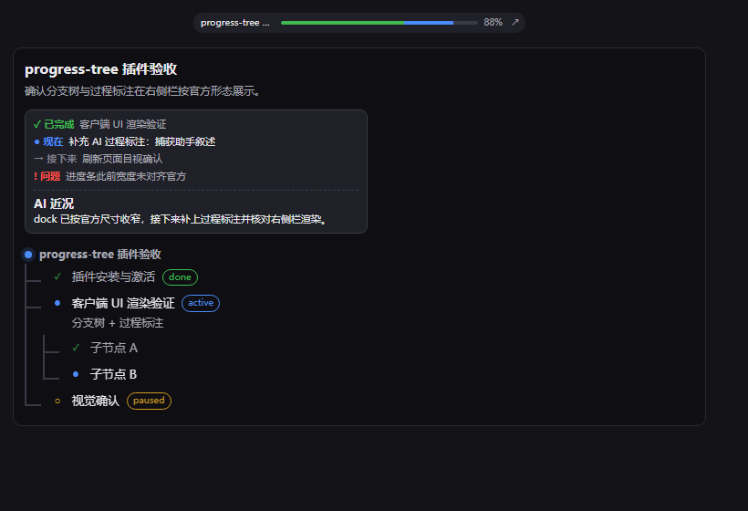

# Progress Tree · 进度树

A live AI task tree in the right sidebar of [DeepSeek Harness](https://github.com/deepseek-ai/deepseek-harness) (DSH): per-step status, blockers, artifacts, a compact progress dock, and an always-visible “what’s done / what’s next / what’s wrong” strip.

DeepSeek Harness 右侧栏任务树插件：把 AI 的多步任务折叠成可扫读的树，实时显示当前节点、状态、阻塞原因与产物，并在输入框上方给出紧凑进度条。

 



## Features

- **Right-sidebar tree** — a real tree with trunk and branch connectors, nested child nodes, parallel lanes, status dots and badges; not a flat list.
- **Live status strip** — pinned rows for 已完成 / 现在 / 接下来 / 问题 (done / now / next / problem). The host projection also captures the assistant’s latest narration as “AI 近况”, so the sidebar updates even between tool calls.
- **Compact dock** — above the composer: plan title, segmented progress bar, done percentage, and an open button. About half the official Timeline TaskDock size (50% width, 18 px tall). The tab opens automatically the first time a plan appears in a session.
- **Status colours** — pending grey, active blue (pulse), done green, blocked red with reason, paused amber.
- **Artifacts** — every node can list files or URLs. File chips open in the sidebar file preview; URLs open in the browser; the path is copied if neither works.
- **Sub-agents in the tree** — `subagent`, `subagent_fork` and `subagent_claude_code` calls add `agent-<callId>` nodes; completion turns them green, failure red.
- **No extra storage** — the tree is folded from the standard `tool/call` / `tool/result` session events with a session projection. No new event type, no `appendPluginRecord`, no plugin files on disk.

## Install

```sh
dsh plugin --profile web add github:sayzwx/dsh-progress-tree
```

Then refresh the Web GUI. To upgrade, remove then add again (`dsh plugin --profile web remove @local/dsh-progress-tree` followed by the add command) — replacing a loaded bundle requires a reload.

Local development instead of GitHub:

```powershell
plugin_manager install_bundle D:\path\to\dsh-progress-tree
```

Tested with DSH `0.2.2-rc.5` (Windows desktop). The bundle declares `dsh.bundle.patch` in `package.json` plus a root `cordis.patch.yml`.

## Usage

1. Enable the plugin and refresh the page.
2. Give the agent a multi-step task. The injected system-prompt section asks it to call `progress_plan` at the start, `progress_update` on every state change, and `progress_note` for noteworthy events.
3. Open **进度树 / Progress tree** from the right-sidebar tab strip or the sidebar guide card; the dock above the composer opens it too.

| Tool | Purpose |
| --- | --- |
| `progress_plan` | Create/replace the tree: `title`, `summary`, `mode`, `lanes`, `tasks` |
| `progress_update` | Update a node (status, note, severity, artifacts, title, parent, lane); a new `id` + `title` appends a node |
| `progress_note` | Append a process note (`text`, `nodeId`, `severity`) |

## Data model

- Projection key `progressTree`, `stateVersion: 3`, folded from `tool/call` and `tool/result`.
- Client reads only the host `wire.view`: `{version, revision, mode, plan, nodes, counts, currentNodeId, lastError, notes, live, updatedAt}`.
- Limits: ≤200 nodes, ≤20 lanes, ≤8 artifacts per node, last 50 notes, last 6 narration entries (280 chars each).
- Session log remains the single source of truth; forks replay the same events and produce the same tree.

## Development

```sh
node --check index.js
node --check client.js
```

- `index.js` — host plugin: projection + three plain `ToolDefinition` objects (hand-written JSON Schema) + system-prompt section. It deliberately has no bare imports, because an external bundle resolves bare specifiers from its own directory.
- `client.js` — browser plugin: right-sidebar tab, dock, locale dictionaries and styles. The `__ModuleLoader__.load({ id })` id must equal the package name; React comes from the module table.
- Bump `stateVersion` whenever the projection semantics change, so old checkpoints are discarded and replayed.

## Layout

```
dsh-progress-tree/
  index.js          host: projection + 3 tools + system prompt
  client.js         client: sidebar tab + composer dock + locale + CSS
  cordis.patch.yml  bundle insertion point
  locale/           en.json / zh.json metadata
  docs/DETAIL.md    plugin detail page
  icon.svg          icon
  assets/           README screenshots
```

## License

MIT © 2026 sayzwx
